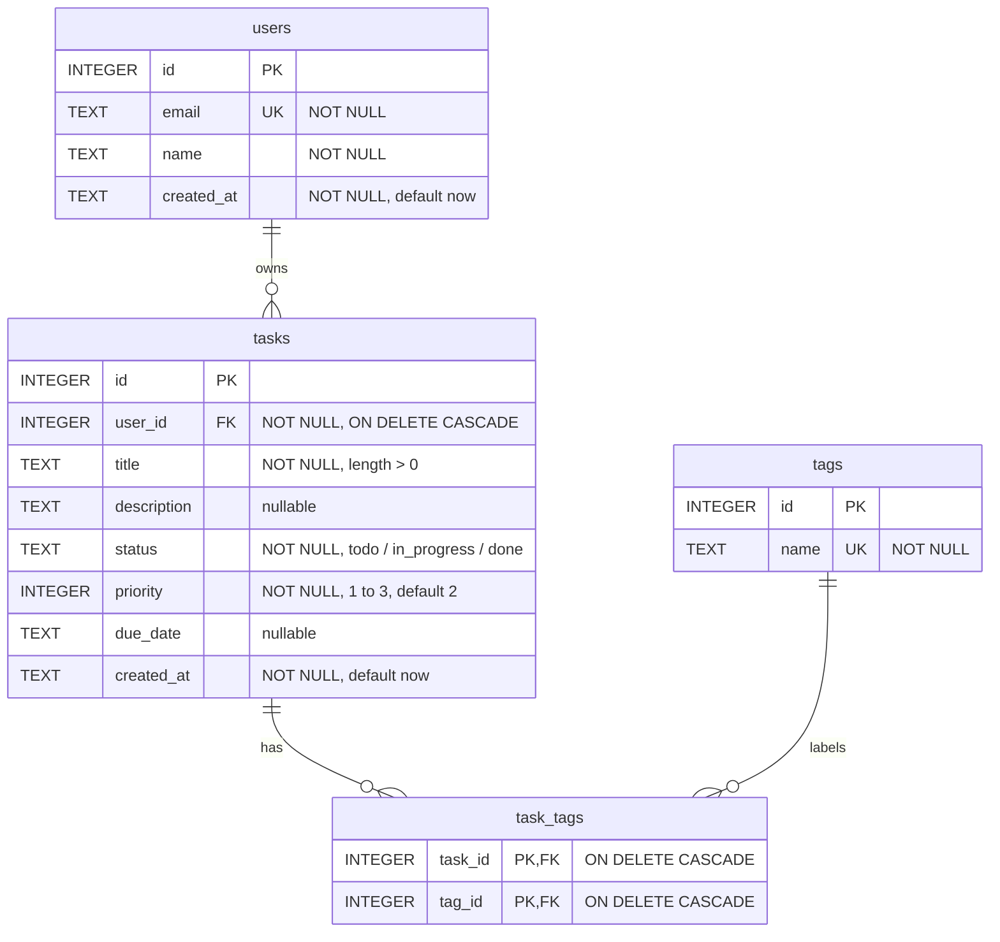

# M06: SQL Fundamentals with SQLite

The Task API schema (`users`, `tasks`, `tags`, `task_tags`) written and queried as plain SQL, before
an ORM hides it. M07 translates this schema into Prisma.

A "module" in this program means a training stage, not a JavaScript module.

## Layout

```text
m06-sql-fundamentals-sqlite/
├─ README.md             this file, with the ERD
├─ schema.sql            the DDL: tables, constraints, foreign keys, indexes
├─ seed.sql              seed data, with ids written out so results repeat
├─ exercises/            25 graded queries in five files
│  ├─ 01-select-filter-sort.sql          1-6
│  ├─ 02-joins.sql                       7-11
│  ├─ 03-aggregates.sql                  12-16
│  ├─ 04-subqueries-and-dml.sql          17-20
│  └─ 05-transactions-and-indexes.sql    21-25
└─ injection-demo/       a SQL injection against a string-built query, and the fix
```

## Run it

Needs the `sqlite3` command line tool (3.15 or later, for the row-value comparison in exercise 6) and
Node.js 24 for the injection demo.

```bash
cd modules/m06-sql-fundamentals-sqlite

# Build the database. m06.db is git-ignored (*.db), so rebuild it any time.
rm -f m06.db
sqlite3 m06.db < schema.sql
sqlite3 m06.db < seed.sql

# Run one exercise file.
sqlite3 m06.db < exercises/01-select-filter-sort.sql
```

Exercise files 04 and 05 change data (20 and 23) and the indexes (24 and 25). Rebuild the database before
every run of those two files, and before running any other file after them.

Exercise 21 fails on purpose: `sqlite3` prints a `CHECK constraint failed` error and exits 1 on a correct
run. The count after its `ROLLBACK` is the result to check. Do not run that file with `-bail`.

```bash
# The injection demo.
cd injection-demo
npm install
npm run typecheck
npm run demo
```

The demo builds its own throwaway in-memory database from `schema.sql` and `seed.sql`, so it writes
no file. It uses `.ts` import specifiers, the same convention as M04.

## Entity relationship diagram



Read it as: one user owns zero or more tasks (1:N), and a task has zero or more tags while a tag
labels zero or more tasks (M:N), which a relational table cannot hold directly. `task_tags` is the
junction table: one row per (task, tag) pair, with the pair as its composite primary key.

Indexes: `idx_tasks_user_id`, `idx_tasks_status` and `idx_task_tags_tag_id`. The composite primary
key of `task_tags` already serves lookups by `task_id`.
